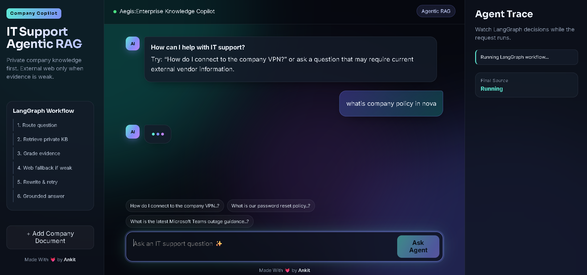

<div align="center">

# ***Aegis IT Support🛡️***
---

### ***🤖 Enterprise Knowledge Copilot • IT Support Agentic RAG***
***Private Knowledge Retrieval • Evidence Grading • Web Fallback • Query Rewrite & Retry • Grounded Answers***

<p align="center">

</p>

<p align="center">


</p>

---

### ***🌟 About Aegis***

***Aegis is an enterprise IT-support copilot built on an agentic RAG workflow. It answers questions from your company's private knowledge base first, and reaches out to the external web only when the internal evidence is weak.***

***The system uses a **LangGraph** workflow that routes the question, retrieves private documents, grades the evidence, falls back to web search when needed, rewrites and retries weak queries, and finally produces a grounded answer, while showing every decision live in an Agent Trace panel.***

<p align="center">
<a href="https://aegis-it.onrender.com/" target="_blank">

</a>
</p>
</div>

---

### ***🌐 Live Demo***

***Web Application 👉 [Aegis – IT Support Agentic RAG](https://aegis-it.onrender.com/)***

---

### ***📸 Project Preview***

<p align="center">

</p>

---

### ***✅ What Aegis Can Do***

- 💬 Chat-style IT support assistant
- 🔒 Private company knowledge retrieval first
- ⚖️ Evidence grading before answering
- 🌐 Web fallback only when private evidence is weak
- 🔁 Query rewrite and retry loop
- 🧾 Grounded answers based on retrieved evidence
- 🔎 Live **Agent Trace** showing LangGraph decisions
- 📄 Add company documents directly from the UI
- 🌑 Modern dark-theme interface with quick-prompt chips

---

### ***🧠 LangGraph Workflow***

```text
                 💬 User Question
                        │
                        ▼
                1. Route Question
                        │
                        ▼
              2. Retrieve Private KB
                        │
                        ▼
                3. Grade Evidence
                        │
             ┌──────────┴──────────┐
             ▼                     ▼
        Evidence Strong       Evidence Weak
             │                     │
             │                     ▼
             │            4. Web Fallback
             │                     │
             │                     ▼
             │            5. Rewrite & Retry
             │                     │
             └──────────┬──────────┘
                        ▼
                6. Grounded Answer
                        │
                        ▼
               Answer + Final Source
```

| Step | Node | Purpose |
|---|---|---|
| 1 | **Route question** | Decide whether the question needs private KB, web, or both |
| 2 | **Retrieve private KB** | Fetch relevant chunks from company documents |
| 3 | **Grade evidence** | Check whether retrieved context actually answers the question |
| 4 | **Web fallback** | Search the external web only if evidence is weak |
| 5 | **Rewrite & retry** | Reformulate the query and try retrieval again |
| 6 | **Grounded answer** | Generate the final answer using only the gathered evidence |

---

### ***🔍 Agentic RAG Pipeline***

```text
Question
  ↓
Intent Routing
  ↓
Private Knowledge Base Retrieval
  ↓
Relevance / Evidence Grading
  ↓
Sufficient?  ── Yes ──▶  Generate Grounded Answer
  │
  No
  ↓
External Web Search (Fallback)
  ↓
Query Rewrite & Retry
  ↓
Generate Grounded Answer
  ↓
Return Answer + Final Source
```

***Unlike a basic RAG chatbot, Aegis does not blindly answer from whatever it retrieves. It evaluates its own evidence and chooses the next action, which is what makes it **agentic**.***

---

### ***💡 Example Questions***

- *How do I connect to the company VPN?*
- *What is our password reset policy?*
- *What is the latest Microsoft Teams outage guidance?* ← requires current external vendor information, so the web fallback may trigger

---

### ***🧩 Tech Stack***

### ***AI & Agents***

- **LangGraph** (agentic workflow orchestration)
- **RAG** (retrieval over private company documents)
- **LLM** for evidence grading, query rewriting and answer generation
- **Web search** fallback for current external information

### ***Application***

- **Python 3.11**
- **API layer** (`agent/api`)
- **Custom dark-theme frontend** (`ui/`)

### ***Deployment***

- **Docker**
- **Render**

---

### ***📁 Project Structure***

```text
Aegis/
│
├── agent/
│   ├── api/                        # API routes
│   ├── core/                       # Core configuration and workflow logic
│   ├── rag/                        # Retrieval and knowledge-base pipeline
│   ├── services/                   # LLM, search and supporting services
│   └── main.py                     # Application entrypoint
│
├── data/                           # Knowledge base data
├── notebook/                       # Experiments and prototyping notebooks
├── preview/
│   └── ui.png                      # Project UI screenshot
├── ui/                             # Frontend (chat UI + Agent Trace panel)
├── uploads/                        # Uploaded company documents
│
├── .dockerignore
├── .env                            # Environment variables (not committed)
├── .gitignore
├── Dockerfile                      # Docker configuration
├── ingest_sample_knowledge.py      # Ingest sample documents into the KB
├── requirements.txt                # Python dependencies
└── schema.py                       # Request/response schemas
```

---

### ***⚙️ Getting Started***

```bash
# 1. Clone the repository
git clone https://github.com/<your-username>/Aegis.git
cd Aegis

# 2. Create and activate a virtual environment
python -m venv venv
source venv/bin/activate        # Windows: venv\Scripts\activate

# 3. Install dependencies
pip install -r requirements.txt

# 4. Configure environment variables
cp .env.example .env            # PowerShell: Copy-Item .env.example .env
# Add GROQ_API_KEY, TAVILY_API_KEY, PINECONE_API_KEY, and a unique ADMIN_API_KEY

# 5. Ingest the sample knowledge base
python ingest_sample_knowledge.py

# 6. Run the application
uvicorn agent.main:app --reload
```

### ***🐳 Run with Docker***

```bash
docker build -t aegis .
docker run -p 8000:8080 --env-file .env aegis
```

The container listens on port `8080`; the command above exposes it locally at
`http://localhost:8000`. Keep `.env` private. The embedding model must match
the configured Pinecone index dimension; the default MiniLM model produces
384-dimensional vectors.

---

### ***🧪 Why Grounded Answers Matter***

Aegis is designed to reduce hallucination in enterprise support:

```text
Private KB Evidence Found?
          ↓
Evidence Good Enough?
          ↓
   YES → Answer from private documents
   NO  → Search web → Rewrite → Retry
          ↓
Answer only from gathered evidence
```

This keeps internal policy answers tied to company documents and uses the web only for questions that genuinely need current external information.

---

### ***⚠️ Limitations***

- Answer quality depends on the quality and coverage of the ingested documents.
- Web fallback results depend on external search availability and source quality.
- Free-tier hosting may have cold starts and non-persistent disk storage.
- LLM and search services require network access and valid API keys.
- Responses should be verified for critical security or compliance decisions.

---

### ***🔮 Future Enhancements***

- Source citations with document links in every answer
- Document-level access control and multi-tenant knowledge bases
- Conversation memory across sessions
- Admin dashboard for document management
- Evaluation suite for retrieval and answer quality
- Slack / Microsoft Teams integration
- Ticket creation for unresolved issues

---

### ***🎯 Real-World Use Cases***

✔ Internal IT Helpdesk Assistant

✔ Employee Self-Service Support

✔ Company Policy Q&A

✔ Enterprise Knowledge Search

✔ Agentic RAG Demonstration

✔ AI/ML Portfolio Project

---

## ***💼 Why This Project Is Valuable for an AI Engineer Portfolio***

Aegis demonstrates an end-to-end agentic AI application rather than only a standalone model.

```text
Retrieval-Augmented Generation
              +
Agentic Workflow (LangGraph)
              +
Evidence Grading
              +
Web Search Fallback
              +
Query Rewriting
              +
Grounded Generation
              +
API Backend
              +
Custom Frontend
              +
Docker
              +
Cloud Deployment
```

---

## ***🧠 Key Learning Outcomes***

1. Design agentic workflows with LangGraph.
2. Build a private-knowledge RAG pipeline.
3. Grade retrieved evidence before answering.
4. Implement web-search fallback logic.
5. Add query rewrite-and-retry loops.
6. Generate grounded, evidence-based answers.
7. Expose agent decisions through a live trace UI.
8. Package the application with Docker.
9. Deploy an AI application to the cloud.

---

## ***🛡️ Safety Notice***

Aegis is an educational and demonstration project. Its answers should not replace official IT, security, or compliance guidance. Always verify critical decisions with your organization's responsible team.

---

## ***👨‍💻 Developer***

<div align="center">

# ***ANKIT GUPTA 👦***

### ***AI Engineer • AI Backend Developer • GenAI & Agentic AI Developer***

**Building practical AI systems with Python, RAG, LangGraph and Agentic AI**

</div>

---

### ***⭐ Support the Project***

If you find Aegis useful or interesting:

- ⭐ Star the repository
- 🍴 Fork the project
- 🐛 Report issues
- 💡 Suggest new features
- 📢 Share the project

---

<div align="center">

### ***Aegis IT: Complete Compnay IT Support Assistant System 🛡️***

***Ask Privately. Verify Smartly. Answer with Evidence.***

### ***Built with ❤️ by Ankit Gupta***

</div>
